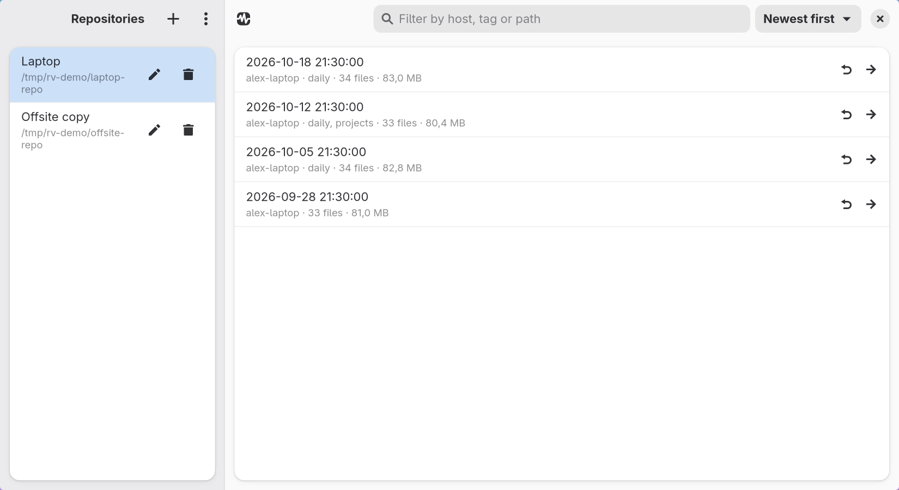
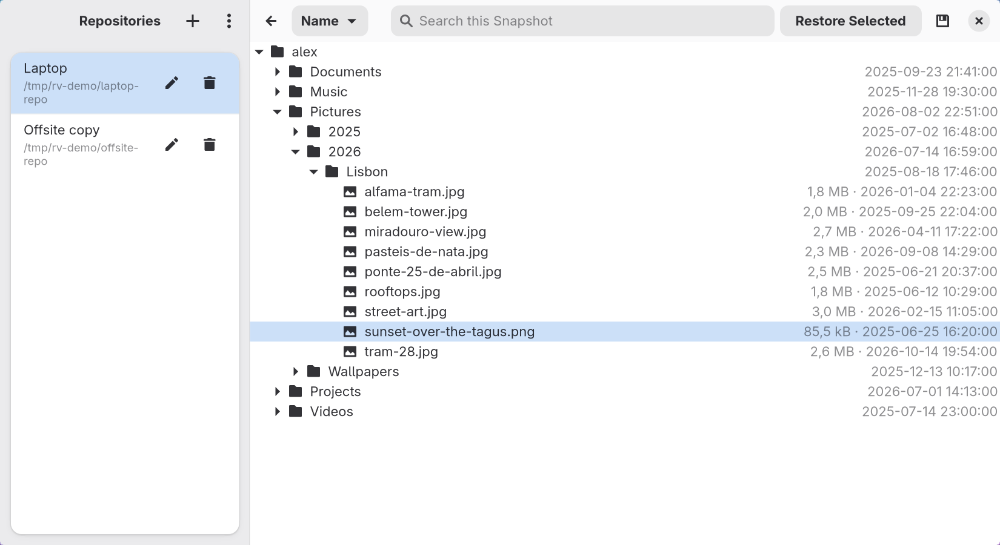
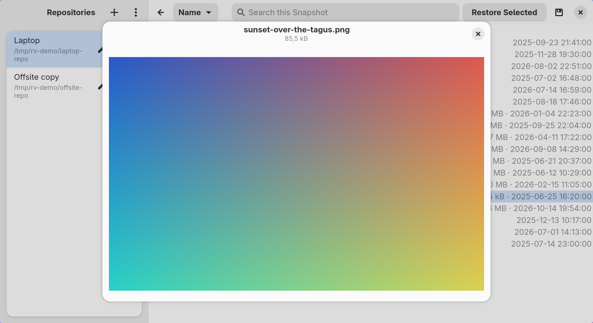
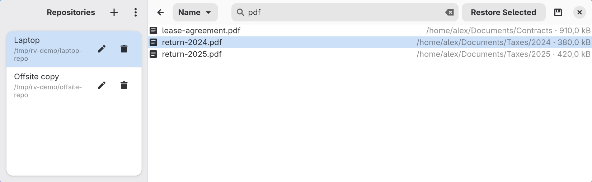
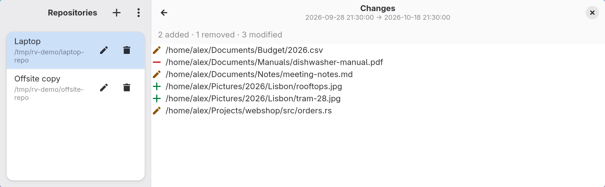
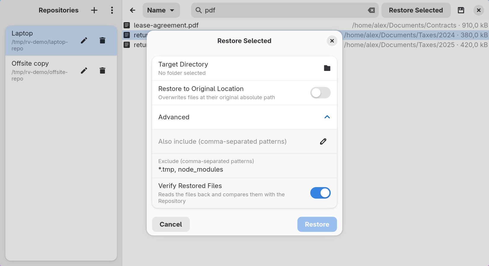

# Restic Viewer

> A native GNOME (GTK4 + libadwaita) app for browsing and restoring restic backup repositories.

[](https://github.com/brpaz/restic-viewer/actions/workflows/ci.yml)
[](LICENSE.md)
[](https://flatpak.org)
[](#restic-viewer)

> [!WARNING]
> **AI usage notice:** this project was fully vibe coded with Claude Sonnet 5.5 to scratch a personal itch. The code has had little human review. Use it at your own risk, and check restored files before relying on them.

<div align="center">



</div>

<table>
  <tr>
    <td><br><sub>Walk a Snapshot's file tree, sorted by name, size or date</sub></td>
    <td><br><sub>Preview images and text without restoring them</sub></td>
  </tr>
  <tr>
    <td><br><sub>Search a Snapshot by file name</sub></td>
    <td><br><sub>See what changed between two Snapshots</sub></td>
  </tr>
  <tr>
    <td colspan="2" align="center"><br><sub>Restore with include and exclude patterns and optional verification</sub></td>
  </tr>
</table>

Restic Viewer attaches to Repositories you already back up elsewhere (via `restic` CLI, cron, or another tool), lets you browse their Snapshots and file trees, and restores what you need — nothing more. It doesn't run backups, doesn't schedule anything, and doesn't touch your Repository's data.

## Features

- **Browse, don't manage** — attach to an existing Local, SFTP, or S3-compatible Repository; list its Snapshots; walk the file tree inside any of them.
- **Find things fast** — filter and sort Snapshots by host, tag, path or size; search a Snapshot by file name; sort the tree by name, size or date.
- **See before you restore** — preview text and images straight from the Repository, and compare any two Snapshots to see what was added, removed or changed.
- **Restore what you need** — pick individual files or a whole Snapshot, restore to a new directory or back to the original path.
- **Save without restoring** — write one file, or a folder as a tar/zip archive, straight to a file of your choice; restore with include/exclude patterns and optional verification.
- **Check before you trust** — see how many Snapshots and how much data a Repository holds, and run restic's read-only integrity check from the app.
- **Live progress, real cancel** — restores stream restic's own progress and can be stopped mid-run.
- **Secrets stay in the keyring** — Repository passwords and Backend credentials live in the system keyring (libsecret), never in a config file.
- **Bundled restic (Flatpak only)** — the Flatpak bundles its own restic build, so it works the moment it's installed; the `.deb`/`.rpm` packages depend on your distro's `restic` package instead.

## Install

Download the package for your system from the [latest release](https://github.com/brpaz/restic-viewer/releases/latest):

```bash
# Flatpak
flatpak install --user ./dev.brunopaz.ResticViewer-*-x86_64.flatpak
flatpak run dev.brunopaz.ResticViewer

# Debian/Ubuntu
sudo apt install ./restic-viewer_*_amd64.deb

# Fedora
sudo dnf install ./restic-viewer-*.x86_64.rpm
```

Each package comes with a `.sha256` file and a build attestation:

```bash
sha256sum --check restic-viewer_*_amd64.deb.sha256
gh attestation verify restic-viewer_*_amd64.deb --repo brpaz/restic-viewer
```

## Build from Source

```bash
git clone https://github.com/brpaz/restic-viewer.git
cd restic-viewer
task flatpak:install:release
```

Requires the Rust stable toolchain, GTK4/libadwaita/libsecret dev headers, and [`flatpak-builder`](https://docs.flatpak.org/). Full prerequisites, running tests, and the Taskfile reference: [CONTRIBUTING.md](CONTRIBUTING.md).

## Contributing

See [CONTRIBUTING.md](CONTRIBUTING.md).

## Contributors

<a href="https://github.com/brpaz/restic-viewer/graphs/contributors">
  
</a>

## Support

If Restic Viewer is useful to you, consider [sponsoring on GitHub](https://github.com/sponsors/brpaz) or [buying me a coffee](https://buymeacoffee.com/z1bu6asgv).

## License

This repo is MIT licensed. See [LICENSE.md](LICENSE.md).
